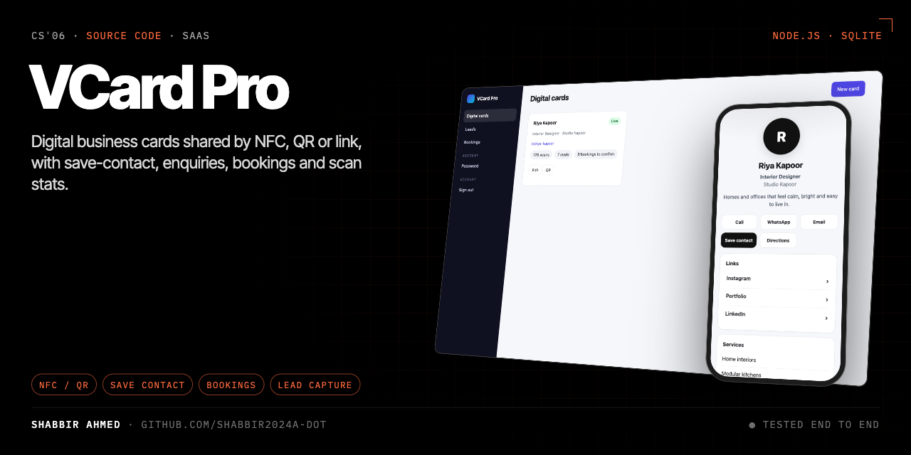
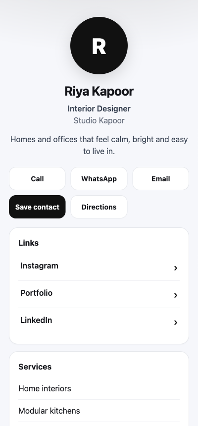
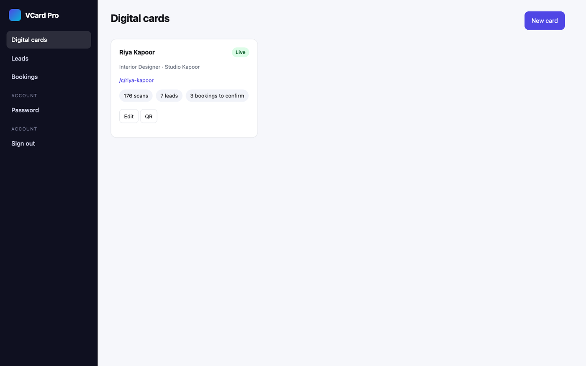

# VCard Pro

Digital visiting cards shared by NFC, QR or link. Visitors can save your contact, call, WhatsApp, get directions, request an appointment or send an enquiry. You see scans, leads and bookings.

## Features

- Public card page with save-contact (.vcf), call, WhatsApp, email and directions
- Links and services sections
- Enquiry form and appointment requests
- QR code per card, and NFC tags with separate tracking
- Scans by source (QR / NFC / link), leads export to CSV

## Screenshots

**Public card on a phone**

**Admin**

## Built with

Node.js 22+ with built-in SQLite · zero dependencies · 10 end-to-end tests

## Get the source code

The source code is **not in this repository**. It is sold as a one-time purchase that includes the full code, a setup guide and a licence to run it for your business or clients.

---

Made by [Shabbir Ahmed](https://github.com/shabbir2024a-dot) · Guwahati, India
